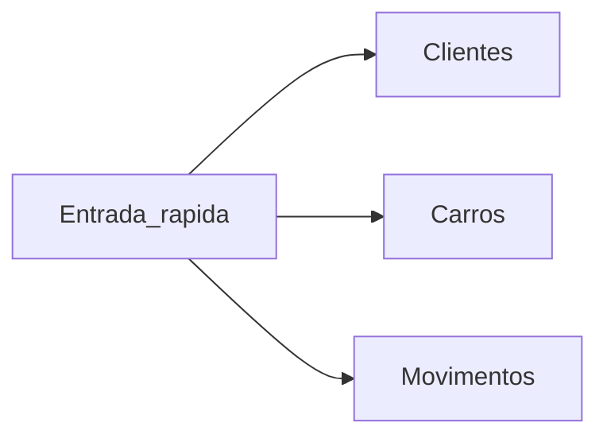

# O que a oficina preenche (cliente + carros + pontos)

## Forma fácil: separador «Entrada»

Não escrevas nas folhas Clientes / Carros / Movimentos.

1. Abre **Entrada**
2. Escolhe o que fazer (Novo cliente / Novo carro / Gasto)
3. Preenche as células amarelas
4. Em **GUARDAR** escreve **SIM**

O script distribui para as folhas certas. Ver [COLOCAR-NO-SHEET.md](COLOCAR-NO-SHEET.md).

Menu opcional **Pontos INOVACAR**: janelas Novo cliente / Novo carro, e Preparar folha.

## Ideia-chave

| Entidade | Chave | Pontos? |
| --- | --- | --- |
| **Cliente** | telemóvel | **Sim** — o saldo é sempre da pessoa |
| **Carro** | matrícula | Não — só identifica o serviço / cronómetro |
| **Movimento** | linha nova | Soma ou tira pontos ao telemóvel |

Um cliente pode ter vários carros. Os pontos **não** se separam por carro.

## Separadores (4)

### `Clientes`

| Campo | Obrigatório | Exemplo |
| --- | --- | --- |
| telemovel | sim | `934000001` |
| nome | sim | `Ana Sousa` |
| ativo | sim | `sim` |
| nota | não | livre |

### `Carros`

| Campo | Quem preenche | Exemplo |
| --- | --- | --- |
| matricula, telemovel, marca, modelo, ano | formulário | `AA-00-BB` … |
| feito | oficina / formulário | `nao` / `sim` |
| entrada_em, pronto_em, duracao_min | automático | cronómetro |

Ao criar o carro (ou «Carro chegou»): `feito=nao` e `entrada_em` = agora.
Em «Carro pronto»: `feito=sim` + duração em minutos.

### `Movimentos`

| tipo | O que preencher | Pontos |
| --- | --- | --- |
| gasto | valor € (+ matrícula) | = euros |
| indicacao | quem trouxe | +300 |
| resgate | prémio | negativo |
| ajuste | pontos à mão | o que escrever |

### `Premios`

Catálogo (`id`, `nome`, `pontos`, `activo`, `descricao`). Editável na folha;
o site actualiza na próxima consulta.

## Indicação (ordem)

1. Criar o **novo** cliente (+ carro se já trouxe o veículo).
2. Registar o **primeiro gasto** do novo.
3. Só então: **Indicação** no telemóvel de quem indicou.

## Site

O cliente mete **só o telemóvel**. O site devolve saldo + movimentos.
A lista de carros é só para a oficina.

### Números estrangeiros

- **Portugal (+351):** 9 algarismos, sem indicativo (`912345678`).
- **Outros:** com indicativo à frente, sem `+` nem `00` (`33612345678`).
