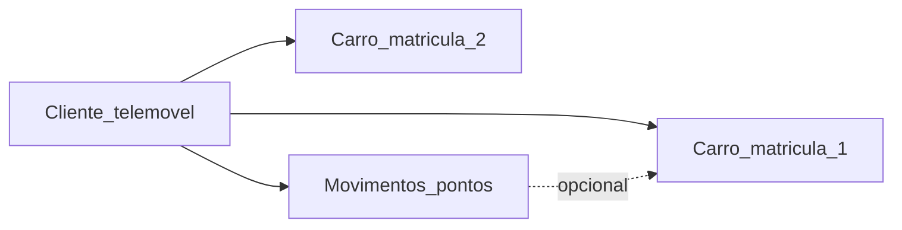

# O que a oficina preenche (cliente + carros + pontos)

## Forma fácil: menu «Entrada rápida»

Não precisa de escrever nas linhas à mão. O formulário abre **dentro da folha**
(painel lateral) — não há página web à parte.

1. O Apps Script tem de estar **ligado a esta folha** (`Extensões` → `Apps Script`
   a partir do Sheet, não um projecto autónomo). Ver [README.md](README.md).
2. Recarregue a folha → menu **Pontos INOVACAR** → **Preparar folha** (uma vez).
3. **Pontos INOVACAR** → **Entrada rápida…**
4. Escolha o que quer fazer e preencha:
   - Novo cliente (+ 1.º carro)
   - Novo carro
   - Carro chegou (reinicia o cronómetro)
   - Carro pronto (marca feito e mostra o tempo)
   - Gasto / serviço
   - Indicação
   - Resgate de prémio

No projecto tem de existir o ficheiro HTML `Formularios`.

## Ideia-chave

| Entidade | Chave | Pontos? |
| --- | --- | --- |
| **Cliente** (pessoa) | telemóvel | **Sim** — o saldo é sempre da pessoa |
| **Carro** | matrícula | Não — o carro só identifica o serviço |
| **Movimento** | linha nova | Soma ou tira pontos ao telemóvel |

Um cliente pode ter **vários carros**. Os pontos **não** se separam por carro:
se a Ana tem Golf e Clio, o saldo é um só (no telemóvel dela).

---

## 1. Novo cliente — folha `Clientes`

| Campo | Obrigatório? | Exemplo | Notas |
| --- | --- | --- | --- |
| **telemovel** | sim | `934000001` | Só dígitos; é a chave da consulta no site |
| **nome** | sim | `Ana Sousa` | Nome para a oficina; no site só aparece o primeiro |
| **ativo** | sim | `sim` | `nao` = deixa de consultar no site |
| **nota** | não | `indicado pela Ana` | Livre |

Não é preciso NIF, morada nem email para o programa de pontos.

---

## 2. Carros desse cliente — folha `Carros`

Uma linha **por carro** (a mesma pessoa pode ter 2, 3, …).

| Campo | Obrigatório? | Exemplo | Notas |
| --- | --- | --- | --- |
| **matricula** | sim | `AA-00-BB` | Chave do carro |
| **telemovel** | sim | `934000001` | Tem de existir em `Clientes` |
| **marca** | sim | `Volkswagen` | |
| **modelo** | sim | `Golf` | |
| **ano** | não | `2018` | Ajuda na oficina |
| **ativo** | sim | `sim` | `nao` se vendeu / deixou de vir |
| **nota** | não | `segundo carro` | Livre |
| **feito** | sim (oficina) | `nao` / `sim` | `nao` = ainda em trabalho |
| **entrada_em** | automático | `2026-10-28 09:10:00` | Quando o carro **aparece** (novo ou «chegou») |
| **pronto_em** | automático | `2026-10-28 11:25:00` | Quando marca **pronto** |
| **duracao_min** | automático | `135` | Minutos entre entrada e pronto |

**Cronómetro na oficina:** ao criar o carro (ou «Carro chegou»), `feito=nao` e
`entrada_em` fica com a hora actual. Em **Carro pronto**, o script põe `feito=sim`,
preenche `pronto_em` / `duracao_min` e diz quanto demorou (ex.: «1 h 23 min»).

**Ordem:** primeiro criar o cliente, depois os carros.

---

## 3. Quando há serviço / indicação / resgate — folha `Movimentos`

| Campo | Obrigatório? | Quando | Exemplo |
| --- | --- | --- | --- |
| **data** | sim | sempre | `2026-10-27` |
| **telemovel** | sim | sempre | telemóvel de **quem ganha ou perde** os pontos |
| **tipo** | sim | sempre | `gasto` · `indicacao` · `resgate` · `ajuste` |
| **valor_eur** | se `gasto` | fatura | `500` → o script põe **500 pontos** |
| **pontos** | quase nunca | o script preenche | em `resgate` pode pôr `-100` ou deixar a `nota` = id do prémio |
| **matricula** | recomendado em `gasto`/`resgate` | qual o carro | `AA-00-BB` |
| **nota** | útil | sempre | `revisão` · `trouxe 934000002` · `lavagem` |

### Tipos

| tipo | O que preencher | Quem recebe pontos |
| --- | --- | --- |
| `gasto` | telemóvel + valor_eur (+ matrícula) | o dono do telemóvel (1 € = 1 pt) |
| `indicacao` | telemóvel de **quem trouxe** | quem trouxe (**300 pts**) |
| `resgate` | telemóvel + prémio (pontos negativos ou id na nota) | tira pontos a quem resgata |
| `ajuste` | telemóvel + pontos à mão | correção pontual |

### Indicação (passo a passo)

1. Criar o **novo** cliente em `Clientes` (+ carro em `Carros` se já trouxe o veículo).
2. Registar o **primeiro gasto** do novo (`tipo=gasto`).
3. Só então: linha `indicacao` no telemóvel de **quem indicou** (nota: telemóvel/nome do novo).

---

## Exemplo rápido — Ana com 2 carros

**Clientes**

| telemovel | nome | ativo |
| --- | --- | --- |
| 934000001 | Ana Sousa | sim |

**Carros**

| matricula | telemovel | marca | modelo | ano |
| --- | --- | --- | --- | --- |
| AA-00-BB | 934000001 | Volkswagen | Golf | 2018 |
| CC-11-DD | 934000001 | Renault | Clio | 2012 |

**Movimentos** (pontos todos na Ana)

| data | telemovel | tipo | valor_eur | matricula | nota |
| --- | --- | --- | --- | --- | --- |
| … | 934000001 | gasto | 200 | AA-00-BB | revisão Golf |
| … | 934000001 | gasto | 80 | CC-11-DD | diagnóstico Clio |

Saldo Ana = 280 pts (e o que mais tiver).

---

## O que o site usa

Na consulta, o cliente mete **só o telemóvel**. O site devolve saldo + movimentos.
A lista de carros é **só para a oficina** (não aparece no site, por agora).
